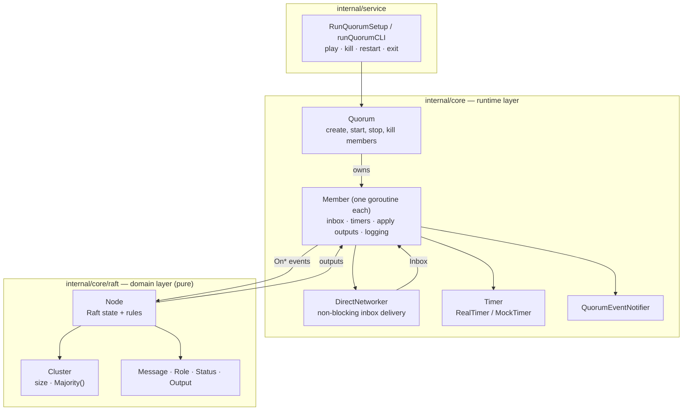
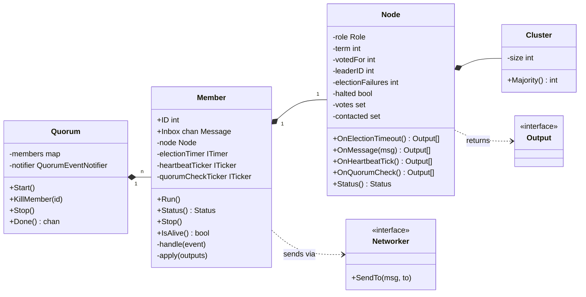
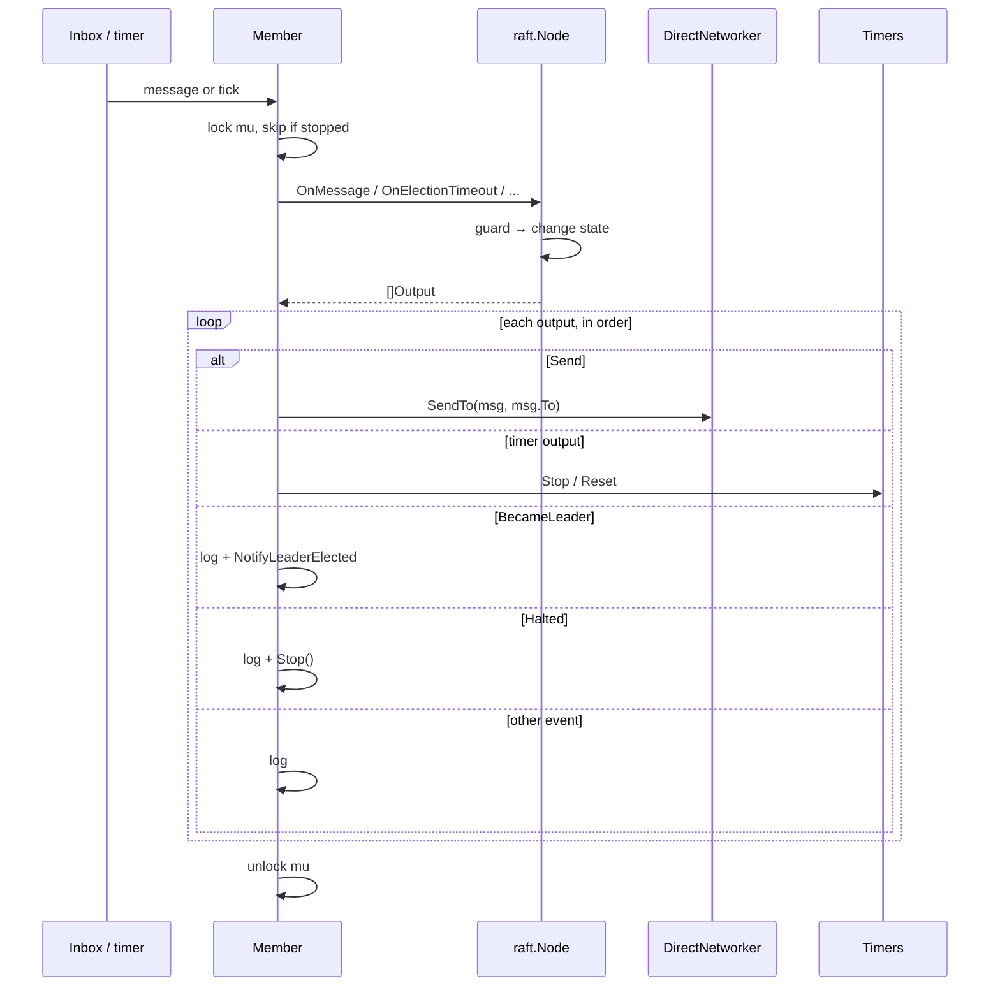
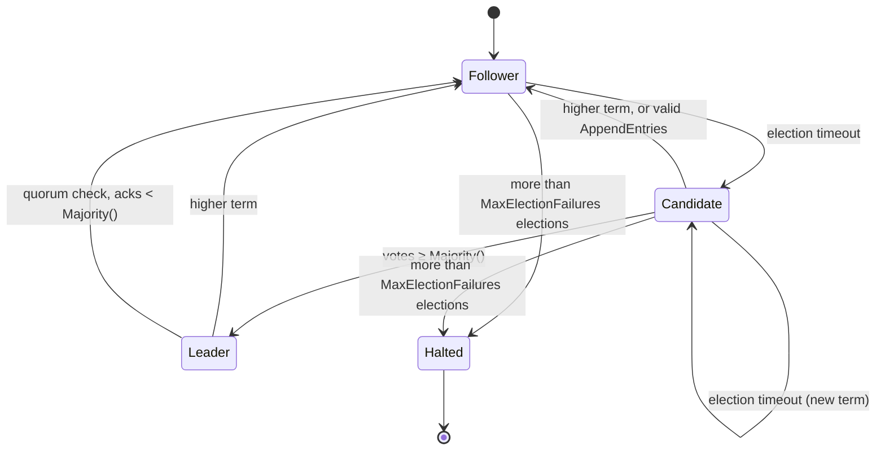
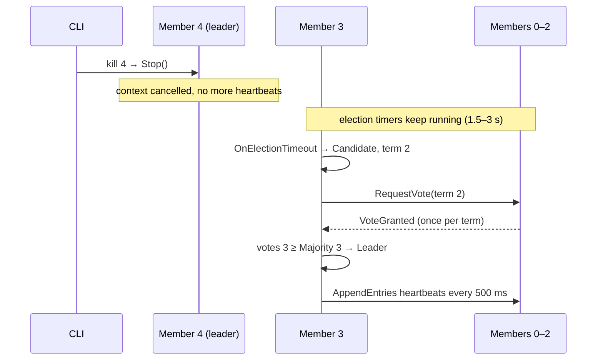

# Architecture

How the simulator is structured after the rich domain model refactor. The
design notes behind it are in [`refactor/`](refactor/).

## 1. Layers

The domain layer (`internal/core/raft`) holds the Raft rules and knows nothing
about goroutines, time, randomness, logging or transport. The runtime layer
(`internal/core`) depends on it, never the reverse.

## 2. Types

`Output` is one of `Send`, `ResetElectionTimer`, `StopElectionTimer`,
`StartHeartbeats`, `StopHeartbeats`, `BecameFollower`, `BecameLeader`,
`StartedElection`, `VoteGranted`, `LostQuorum` or `Halted`.

## 3. How an event flows

Every event follows the same path: the member takes its lock, asks the node
what to do, and executes the answer in order. The node itself never sends,
sleeps or logs.

## 4. Node roles

`Halted` is a flag (`Status.Halted`), not a `Role`: a halted node keeps its
last role but ignores every event. A valid heartbeat or winning an election
resets the failure count.

## 5. Example: a leader is killed

Five members; member 4 leads term 1 and is killed from the CLI.

