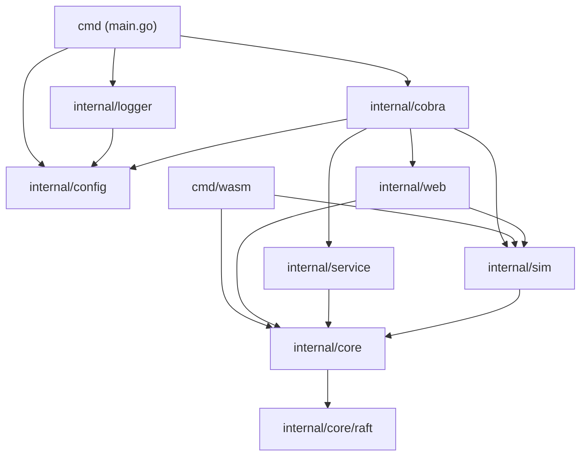
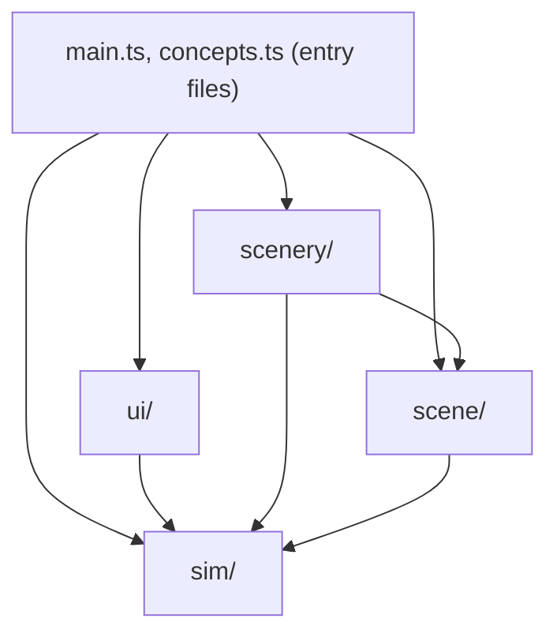
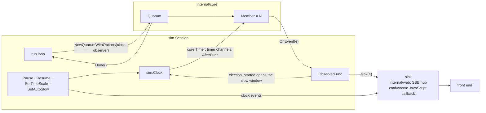
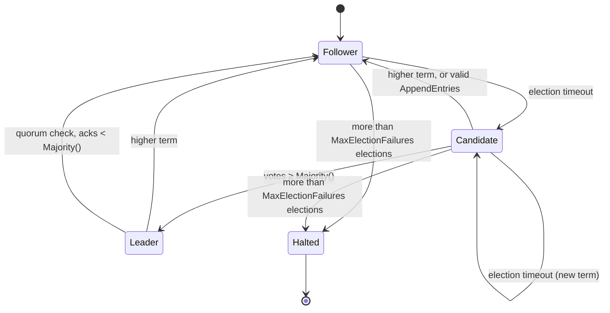

# Architecture

How the code is layered, which seams connect the layers, and what checks each
rule. It states rules and points at the code; read the code for types and
fields. Build and run instructions are in the [readme](../readme.md).

## Go packages

Arrows are imports, as `go list` reports them (`cmd/wasm` with
`GOOS=js GOARCH=wasm`).

- `internal/core/raft` holds the election rules and state of one node. It
  imports nothing: no goroutines, time, randomness, logging or transport.
- `internal/core` runs a cluster: one goroutine per `Member`, timers, message
  delivery, logging, and the event stream. It knows nothing about the CLI, the
  browser or slow motion.
- `internal/sim` keeps one cluster running for a viewer. It owns the
  simulation clock (`sim.Clock`: pause, resume and a time factor), simulated
  message latency, kill, restart, and restart after every member stops. It
  knows nothing about HTTP or JavaScript.
- `internal/web` exposes a `sim.Session` over HTTP and Server-Sent Events and
  serves the front end embedded from `internal/web/dist`.
- `cmd/wasm` exposes a `sim.Session` to JavaScript as `globalThis.quorumSim`.
- `internal/service` is the interactive `play` command. It drives
  `core.Quorum` directly and does not use `internal/sim`.
- `internal/cobra` wires the `play`, `serve` and `version` commands;
  `internal/config` and `internal/logger` hold the version and log setup.

## Front end (`web/src`)

Arrows are the imports the folder rule allows; each folder may also import
from itself.

- `sim/` turns the event stream into cluster state, mirrors the simulation
  clock (`clock.ts`) and talks to the simulation. It knows nothing about
  three.js or how anything is drawn.
- `scene/` holds three.js building blocks that every theme shares: the stage,
  members, packets, shapes, palette and seeded randomness.
- `scenery/` holds the themes, each built from `scene/` parts.
- `ui/` is the HTML overlay. It reads `sim/` state and reports user actions
  through callbacks; it knows nothing about three.js.
- `main.ts` (the visualizer) and `concepts.ts` (a development page that
  compares themes) wire the folders together.

## Seams

| Seam | Defined in | What it separates |
| --- | --- | --- |
| `raft.Output` | `internal/core/raft/output.go` | The node returns ordered decisions; `Member.apply` in `internal/core/member.go` executes them. |
| `core.Timer` | `internal/core/timer.go` | Election timers, leader tickers and delayed calls. `RealTimer` and `MockTimer` (`internal/core/test_util.go`) implement it; a `Session` passes its `sim.Clock` (`internal/sim/clock.go`), which also schedules message and restart delays. |
| `core.Networker` | `internal/core/quorum.go` | Message delivery. `DirectNetworker` writes to inbox channels without blocking. |
| `core.Observer`, `core.Event` | `internal/core/observer.go` | Every observable change as one flat JSON record. It is the wire format the front end reads, mirrored in `web/src/sim/events.ts`. |
| `SimSource` | `web/src/sim/source.ts` | Where events come from and where commands go: `ServerSource` or `WasmSource`. |
| `Theme` | `web/src/scenery/kit.ts` | Scenery, lighting and member styling for one setting. |

An event in a member follows one path: `Member.handle` takes the member's lock,
calls one `raft.Node` method, executes the returned outputs in order, and
reports a status event if the node's status changed.

### Time in, events out

`internal/core` takes time in through `core.Timer` and reports out through
`core.Observer`. It does not know what is on either side. In a `sim.Session`:

- **Time comes in through `core.Timer`.** A `Session` passes its `sim.Clock`, so
  pausing or slowing the clock pauses or slows every election timeout,
  heartbeat, quorum check and message delay together. `play` passes
  `core.NewRealTimer()` and the core tests pass `MockTimer`; `core` cannot tell
  them apart.
- **A member reacts to time inside `core`.** It reads its own timer channels
  and asks its `raft.Node` what to do. Nothing outside `core` starts an
  election.
- **Events go out one way, through `core.Observer`.** `core` calls `OnEvent`
  and reads nothing back. The session's `ObserverFunc` forwards each event to
  its sink and drops the events of a cluster it is replacing. Whoever creates
  the session chooses the sink: `internal/web` publishes to its SSE hub, and
  `cmd/wasm` hands JSON to JavaScript. The session sends its own `clock` events
  to the same sink.
- **One event changes the clock.** While automatic slow motion is on, the
  observer forwards `election_started` and then opens a 600 ms window, in
  simulated time, in which the slow-motion factor is 3 times the chosen
  one. The window ends on time or when the session replaces the cluster.
- **The session's control does not use events.** It learns that every member
  has stopped from `Quorum.Done()`, then waits `restartDelay` on its clock
  before it starts a fresh cluster.

## Run modes

Both modes run the same `internal/sim` and `internal/core` code and deliver the
same JSON-encoded `core.Event` values to the same front end. Vite builds the
front end once per mode (`web/vite.config.ts`); `main.ts` picks the source by
build mode.

- **Go server.** `serve` runs `web.Run` (`internal/web/serve.go`). The browser
  reads `GET /api/events` as Server-Sent Events, starting with a snapshot of
  the running cluster, and sends `POST /api/kill`, `/api/restart`, `/api/pause`,
  `/api/resume`, `/api/timescale` and `/api/autoslow`.
  `ServerSource` is the client.
- **WebAssembly.** The static site on Cloudflare Pages loads `quorum.wasm`,
  built from `cmd/wasm`, and the simulation runs in the tab. `WasmSource`
  calls `quorumSim.start`, `kill`, `restart`, `pause`, `resume`,
  `setTimeScale` and `setAutoSlow` and receives each event as a
  JSON string.

The `play` command uses neither: it logs to the terminal and emits no events.

The simulation clock is described in [`sim-clock/`](sim-clock/); its pull
request 4 is still planned.

## Node roles

`Halted` is a flag (`Status.Halted`), not a `Role`: a halted node keeps its
last role but ignores every event. A valid heartbeat or winning an election
resets the failure count. The rules are in `internal/core/raft/node.go`.

## Rules and what enforces them

| Rule | Enforced by |
| --- | --- |
| `raft` does not import `core`, `sim` or `web`; `core` does not import `sim` or `web`; `sim` does not import `web`. | Compiler (each would be an import cycle) |
| `raft` imports nothing else (no `time`, `math/rand`, `sync`, logging). | Review only |
| No Go package imports a package above it in the diagram. | Review only |
| `core.Event` JSON fields (and `omitempty` versus optional), `EventType` values, message kinds and roles match `web/src/sim/events.ts`. | `internal/core/event_contract_test.go` |
| `web/src` folders import only in the directions of the front-end diagram. | `scripts/web-import-direction.test.mjs` |
| `ServerSource` and `WasmSource` offer the same commands. | Compiler (`tsc`, both implement `SimSource`) |
| `cmd/wasm`'s `quorumSim` matches `QuorumSimApi` in `web/src/sim/source.ts`, and `internal/web` routes match `ServerSource`. | Review only |
| Every theme provides what `Theme` requires. | Compiler (`tsc`) |
| `Observer` implementations are safe for concurrent use and never block. | Review only |

CI (`.github/workflows/ci.yml`) runs both tests: `go test -race ./...` and
`node --test scripts/*.test.mjs`.

## Where to add things

- **A theme.** Add a file under `web/src/scenery/` that exports a `Theme`,
  built from `scene/` parts, and select it in `main.ts` or show it in
  `concepts.ts`. A part that more than one theme needs goes in `scene/`.
- **An event field or type.** Change `core.Event` or the constants in
  `internal/core/observer.go`, emit it from `internal/core`, then mirror it in
  `web/src/sim/events.ts`; the contract test fails until both sides agree.
  Handle it in `web/src/sim/state.ts` or `main.ts`.
- **A command from the UI.** Add a method to `sim.Session`
  (`internal/sim/session.go`), a route in `internal/web/server.go`, a function
  on `quorumSim` in `cmd/wasm/main.go`, and a method on `SimSource` with both
  implementations in `web/src/sim/source.ts`. The UI reaches it through a
  callback such as `HudActions` in `web/src/ui/hud.ts`, wired in `main.ts`.
- **A Raft rule.** Change `internal/core/raft/node.go` and test it in
  `node_test.go` without goroutines or sleeps. If the rule needs a new effect,
  add an `Output` in `output.go` and execute it in `Member.apply`.
