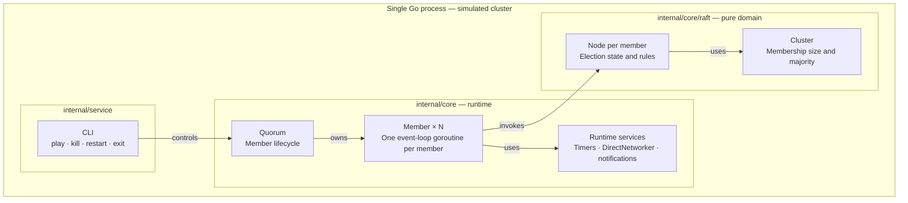

# Quorum Election Simulator

An interactive Go CLI for exploring **Raft leader election and failover**.
Start a simulated cluster, stop its leader, and watch the remaining members
hold a new election.

All members run as goroutines inside a single process and communicate through
in-memory channels. The project separates pure election rules from runtime
concerns so the protocol can be tested without timers or goroutines. It covers
leader election and heartbeats; log replication and persistent storage are
outside its scope.

[Quick start](#quick-start) · [Try a failover](#try-a-failover) ·
[Architecture](#architecture) · [Build from source](#build-from-source) ·
[Tests](#tests) · [Limitations](#limitations) · [Further reading](#further-reading)

## Quick start

Download and extract the ZIP from [v0.2.0](https://github.com/yusaanthya/quorum-election-simulator/releases/tag/v0.2.0).
It includes binaries for Windows, macOS (`darwin`), and Linux, each for `amd64`
and `arm64`. You do not need Go to run a prebuilt binary.

Open a terminal **inside the extracted directory containing the binaries and
`log/`**. Logs are written to the terminal and to `log/log_output.txt`, relative
to the working directory.

### Windows (PowerShell)

Run these commands for an x64 Windows machine:

```powershell
.\quorum_election_app_windows_amd64.exe version
.\quorum_election_app_windows_amd64.exe play --members 5
```

Use the `windows_arm64.exe` binary on ARM64 Windows. Launch the executable from
PowerShell or Command Prompt; double-clicking it displays a command-line-tool
notice instead of starting the simulation.

### Linux or macOS

For Linux amd64:

```sh
chmod +x quorum_election_app_linux_amd64
./quorum_election_app_linux_amd64 version
./quorum_election_app_linux_amd64 play --members 5
```

On macOS, substitute `quorum_election_app_darwin_arm64` for Apple Silicon or
`quorum_election_app_darwin_amd64` for Intel. For Linux ARM64, use
`quorum_election_app_linux_arm64`. The v0.2.0 Linux amd64 binary is dynamically
linked and requires a compatible glibc environment.

The `version` command should report `0.2.0`. Omitting `--members` starts three
members; `-m` is shorthand for `--members`.

## Try a failover

With five members running:

1. Wait for a log entry such as `Member 2: Won election for term 1 with 3 votes`.
   The actual leader ID and term vary between runs.
2. Enter `kill 2` if member 2 is the current leader.
3. Watch the remaining members elect a new leader in a higher term. Five
   configured members require three votes, even after one member is stopped.
4. Enter `restart` to start a fresh cluster, or `exit` to leave the application.

These commands are entered **inside the running simulation**, not in your shell:

| Command | Effect |
| --- | --- |
| `kill <member_id>` | Stops that member's event loop and timers. IDs run from `0` to `N - 1`. |
| `restart` | Stops the current cluster and starts a fresh one with the same member count. |
| `exit` | Stops the cluster and exits the CLI. |

If too few members remain to form a majority, elections keep failing until the
surviving members halt. Once all members stop, the CLI automatically starts a
fresh cluster. Ending a quorum does not exit the application.

## Architecture

### Responsibilities and boundaries

`internal/service` controls the interactive session. `internal/core` owns
concurrency, timers, and message delivery. It depends on `internal/core/raft`,
which holds election state and rules without importing the runtime package.



Arrows show control, ownership, or use as labeled. Each `Member` owns one
`raft.Node`; `DirectNetworker` delivers messages to buffered inbox channels
within the same process.

| Component | Responsibility |
| --- | --- |
| `Quorum` | Creates members, starts and stops them, and signals when all have stopped. |
| `Member` | Runs an event loop, synchronizes access to node state, and executes outputs. |
| `raft.Node` | Owns role, term, votes, and election rules; returns ordered outputs without performing I/O. |
| `raft.Cluster` | Computes the majority from the fixed membership size. |
| `Timer`, `Networker`, `QuorumEventNotifier` | Provide boundaries for timing, message delivery, and notifications. |

### From an event to its effects

The domain decides what should happen; the runtime performs the effects.
An active member processes each event under its mutex:

```mermaid
sequenceDiagram
    participant E as Inbox / timer
    participant M as Member (runtime)
    participant N as raft.Node (domain)
    participant IO as Transport / timers / notifier
    E->>M: Message or timer event
    M->>M: Lock state; ignore if stopped
    M->>N: OnMessage / OnElectionTimeout / other event
    N->>N: Apply election rules and update state
    N-->>M: Ordered outputs (Send, ResetElectionTimer, ...)
    M->>IO: Execute requested effects in order
    M->>M: Unlock state
```

For example, an election timeout can produce `StartedElection`,
`ResetElectionTimer`, and `Send` outputs. `Member` logs the transition, resets
the timer, and sends the vote requests in the returned order. `raft.Node` itself
has no goroutines, randomness, timers, logging, or I/O.

This boundary lets domain tests drive elections through direct method calls.
Runtime tests exercise message delivery, timers, and member lifecycle. Detailed
class diagrams, role transitions, and a failover sequence are in
[the architecture guide](docs/architecture.md).

### Election behavior

- **Election:** a timeout makes a follower a candidate. It increments its term,
  votes for itself, and requests votes from peers. A majority is
  `floor(N / 2) + 1`.
- **Voting:** each member votes for at most one candidate per term. Duplicate
  replies do not count twice, and stale vote replies cannot win an election.
- **Heartbeats:** leaders send `AppendEntries` as heartbeats. A valid heartbeat
  resets the follower's election timer; higher-term protocol messages make an
  active node step down to follower.
- **Quorum check:** the leader periodically counts members that acknowledged
  heartbeats, including itself. Without a majority, it steps down.
- **Election failure limit:** after five unsuccessful election attempts, the
  next election timeout halts the member. Accepting a valid heartbeat or
  becoming leader resets the failure count.
- **Member shutdown:** context cancellation stops member event loops and their
  timers; `Quorum.Stop()` waits for those goroutines to finish.

| Runtime timer | Interval |
| --- | --- |
| Election timeout | Randomized from 1,500 ms up to, but excluding, 3,000 ms |
| Leader heartbeat | 500 ms |
| Leader quorum check | 2,000 ms |

## Build from source

Requires Git and **Go 1.24.1 or later**, as declared in [go.mod](go.mod).
Run these commands from a terminal:

```sh
git clone https://github.com/yusaanthya/quorum-election-simulator.git
cd quorum-election-simulator
go run ./cmd/main.go version
go run ./cmd/main.go play --members 5
```

The repository includes `log/`; keep it in your working directory. To build a
native executable on Linux or macOS:

```sh
go build -o quorum_election ./cmd/main.go
./quorum_election play --members 5
```

On Windows PowerShell:

```powershell
go build -o quorum_election.exe ./cmd/main.go
.\quorum_election.exe play --members 5
```

### Cross-platform builds with Make

Use GNU Make and a Unix-like shell:

```sh
make all
# Or build just one platform:
make build-quorum-election-linux-amd64
```

Outputs are placed in `bin/quorum-election/`, alongside an empty `log/`
directory. Targets support `windows`, `darwin`, and `linux` with `amd64` and
`arm64`; Windows outputs have an `.exe` extension. For example:

```sh
cd bin/quorum-election
./quorum_election_app_linux_amd64 play --members 5
```

From the repository root, `make clean all VERSION=0.2.0` rebuilds all platforms
with an explicit version. Without `VERSION`, builds retain the version in
[`internal/config/config.go`](internal/config/config.go). Plain `make` only
creates the output directory; use `make all` to build binaries.

## Tests

From the repository root:

```sh
go test ./...
go test -race ./...
```

- [Domain tests](internal/core/raft/node_test.go) cover majority voting,
  duplicate and stale replies, one vote per term, heartbeats, quorum loss, and
  the election failure limit without goroutines or sleeps.
- [Runtime tests](internal/core/core_test.go) cover initialization, leader
  election, failover, and termination after quorum loss using a mock timer.
  They still use short sleeps to allow goroutines to run.

Run the failover test alone with:

```sh
go test ./internal/core -run '^TestFailoverReElection$' -count=1
```

## Limitations

- **Election simulator:** no log replication, snapshots, or persistence of
  terms and votes. It is not a production Raft implementation.
- **Single-process transport:** messages use buffered channels, not a real
  network. A full inbox drops messages; network delay and partitions are not
  explicitly simulated.
- **Static membership:** stopped members still count toward the original
  majority. `restart` creates an entirely new cluster rather than recovering
  a stopped member's state.
- **Working-directory requirement:** a writable `log/` directory must exist
  wherever the application is launched.

Potential extensions include simulated network faults, persistent term and vote
storage, log replication, and dynamic membership.

## Further reading

- [Architecture guide](docs/architecture.md): layers, types, event flow, role
  transitions, and a leader-failure example.
- [Refactor design](docs/refactor/02-spec.md): the move from member-owned rules
  to a pure Raft domain model.
- [Makefile design](docs/makefile-cleanup/01-spec.md): build behavior and its
  acceptance criteria.

The project evolved from heartbeat-based member removal to Raft elections,
then separated the protocol from its runtime. The domain refactor also fixed
same-term double voting and member-state races, connected leader-election
notifications, and removed obsolete code.

Built with [Cobra](https://github.com/spf13/cobra) for CLI commands and
[Logrus](https://github.com/sirupsen/logrus) for logging.
