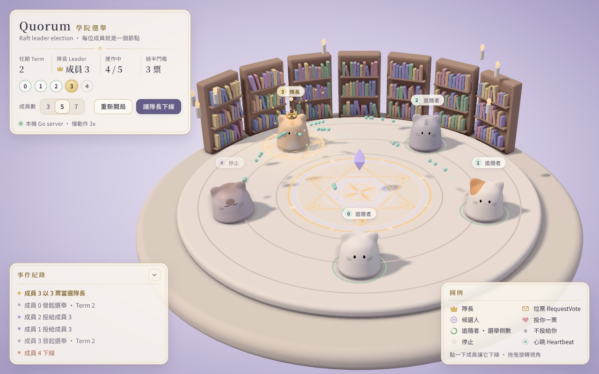
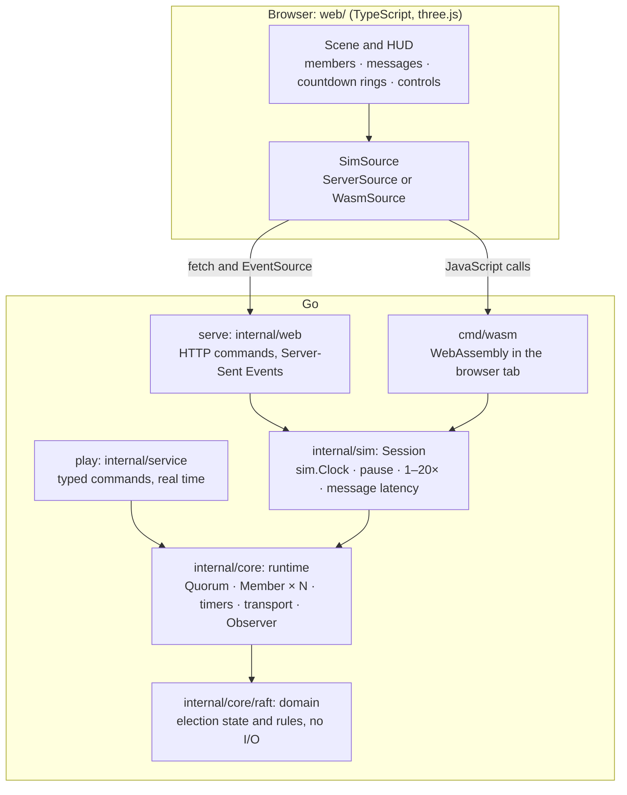
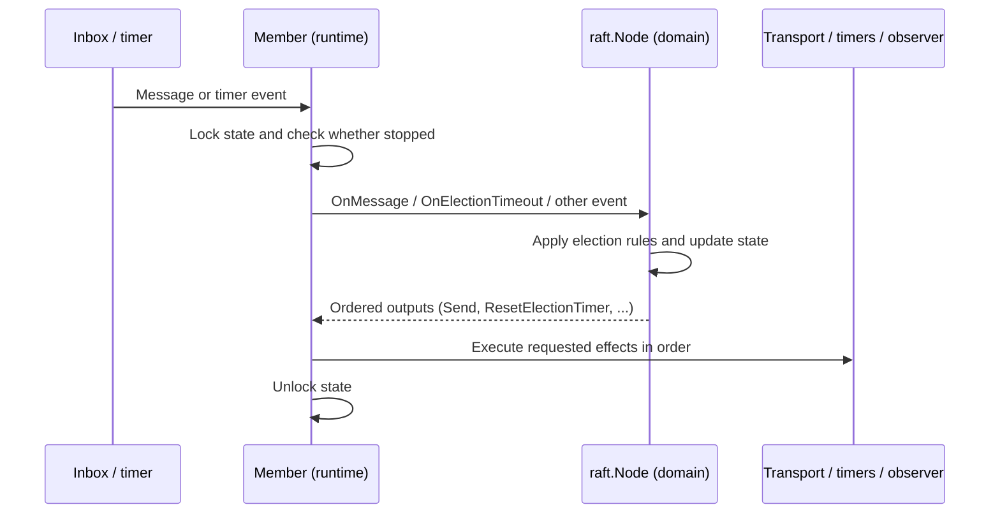

# Quorum Election Simulator

A Go simulator for exploring **Raft leader election and failover**. Start a
simulated cluster, stop its leader, and watch the remaining members hold a new
election in the terminal or in a 3D browser scene that you can pause and slow
down.

All members run as goroutines in a single process and communicate over
in-memory channels. The election rules live in a pure domain package with no
timers, goroutines, or I/O, so the protocol can be tested directly. The
simulator covers leader election and heartbeats; log replication and persistent
storage are out of scope.

**[Open the live visualizer](https://quorum-kitties.pages.dev/)**: it runs
entirely in your browser with nothing to install.



[Ways to run it](#ways-to-run-it) · [Watch an election](#watch-an-election) ·
[Try a failover in the terminal](#try-a-failover-in-the-terminal) ·
[How it works](#how-it-works) · [Build from source](#build-from-source) ·
[Tests and CI](#tests-and-ci) · [Status and limitations](#status-and-limitations) ·
[Further reading](#further-reading)

## Ways to run it

| Mode | What you get | What you need |
| --- | --- | --- |
| [Live site](https://quorum-kitties.pages.dev/) | The 3D visualizer, with the simulation running in the browser tab as WebAssembly | A browser |
| `serve` | The same visualizer, served by a local Go process | A release binary, or Go and Node.js |
| `play` | A text-only cluster you control by typing commands | A release binary, or Go |

### Download a release

Download and extract the [v0.4.0](https://github.com/yusaanthya/quorum-election-simulator/releases/tag/v0.4.0)
ZIP archive. It includes prebuilt binaries for Windows, macOS (`darwin`), and
Linux on both `amd64` and `arm64`, each with the visualizer embedded. Running a
prebuilt binary does not require Go or Node.js.

Open a terminal **inside the extracted directory containing the binaries and
`log/`**. The application writes logs to the terminal and to
`log/log_output.txt` relative to the working directory.

On x64 Windows (PowerShell):

```powershell
.\quorum_election_app_windows_amd64.exe version
.\quorum_election_app_windows_amd64.exe serve --members 5
.\quorum_election_app_windows_amd64.exe play --members 5
```

On ARM64 Windows, use the `windows_arm64.exe` binary. Run the executable from
PowerShell or Command Prompt; double-clicking it shows a command-line-tool
notice instead of starting the simulation.

On Linux amd64:

```sh
chmod +x quorum_election_app_linux_amd64
./quorum_election_app_linux_amd64 version
./quorum_election_app_linux_amd64 serve --members 5
./quorum_election_app_linux_amd64 play --members 5
```

On macOS, replace the binary name with `quorum_election_app_darwin_arm64` for
Apple Silicon or `quorum_election_app_darwin_amd64` for Intel. On Linux ARM64,
use `quorum_election_app_linux_arm64`. The v0.4.0 Linux amd64 binary is
dynamically linked and requires a compatible glibc environment.

The `version` command reports `0.4.0`. `serve` listens on
<http://localhost:8080>. Omitting `--members` starts three members; `-m` is
shorthand for `--members`.

## Watch an election

The visualizer renders the cluster as a small magic academy hall where each
member is a round cat standing around a rune circle. Candidates hop on a silver
circle, the leader wears a crown and stands on a gold circle, and stopped
members close their eyes and slump. Messages fly between members: letters are
vote requests, hearts are granted votes, grey pebbles are refusals, and mint
dots are heartbeats. While no leader is alive, a ring beneath each follower
counts down its election timeout.

In-page controls (labels are in Traditional Chinese):

| Control | Effect |
| --- | --- |
| Click a member | Stops that member. |
| Drag | Rotates the view. |
| `讓隊長下線` (stop the leader) | Stops the current leader. |
| `3` / `5` / `7` | Starts a fresh cluster with that many members. |
| `重新開局` (restart) | Starts a fresh cluster with the current member count. |
| `慢動作` (slow motion) `1×` to `20×` | Slows all timers and messages by the selected factor; `1×` is real time. |
| `暫停` / `繼續` (pause / resume) | Pauses or resumes the simulation, including messages in flight and countdown rings. |
| `選舉時自動放慢` (slow down during elections) | On by default. Multiplies the slow-motion factor by 3 for 600 ms of simulated time after each election starts. On the live site and in builds from `main`; v0.4.0 does not have it. |
| `圖例` (legend) | Explains the member states and message shapes. |

`serve` accepts these flags:

| Flag | Default | Effect |
| --- | --- | --- |
| `--addr` | `:8080` | Address to listen on |
| `--slowmo` | `3` | Initial slow-motion factor, clamped to 1–20; `1` is real time |
| `--members`, `-m` | `3` | Initial member count (1–9) |

The live site accepts the same settings via URL query parameters, such as
`?members=7&slowmo=10`. Without them, it starts five members at `3×`.

The visualizer adds a simulated one-way message delay of 180–260 ms (in
simulated time), so messages arrive when the receiving member processes them.
`play` delivers messages instantly.

## Try a failover in the terminal

With five members running in `play`:

1. Wait for a log entry such as `Member 2: Won election for term 1 with 3 votes`.
   The leader ID and term vary between runs.
2. Enter `kill 2` if member 2 is the current leader.
3. Watch the remaining members elect a new leader in a higher term. A
   five-member cluster requires three votes for a majority, even after one
   member is stopped.
4. Enter `restart` to start a fresh cluster, or `exit` to quit the application.

Enter these commands **inside the running simulation**, not in your shell:

| Command | Effect |
| --- | --- |
| `kill <member_id>` | Stops that member's event loop and timers. IDs run from `0` to `N - 1`. |
| `restart` | Stops the current cluster and starts a fresh one with the same member count. |
| `exit` | Stops the cluster and exits the CLI. |

If too few members remain to form a majority, elections fail repeatedly until
the surviving members halt. Once all members have stopped, the CLI
automatically starts a fresh cluster. Losing a quorum does not exit the
application.

`play` runs in real time; pause and slow motion are available only in the
visualizer.

## How it works

### Run modes and layers

All three entry points share a single election runtime. Both visualizer modes
also share the same front end and `internal/sim`, which owns the simulation
clock.



Arrows point from each caller to what it uses. In `internal/core`, every state
change, timer reset, and message becomes a JSON `core.Event`. `internal/sim`
forwards these events to `internal/web` or `cmd/wasm`, which deliver them to
`SimSource` in the same format.

| Component | Responsibility |
| --- | --- |
| `raft.Node` | Owns role, term, votes, and election rules; returns ordered outputs without performing I/O. |
| `raft.Cluster` | Computes the majority from the fixed membership size. |
| `Quorum` | Creates, starts, and stops members, and signals when all have stopped. |
| `Member` | Runs one event-loop goroutine, synchronizes access to its node, and executes the node's outputs. |
| `Timer`, `Networker`, `Observer` | Boundaries for timing, message delivery, and the event stream. |
| `sim.Session` | Manages a running cluster for the visualizer: handles kill, restart, pause, slow motion, and message delay, and starts a fresh cluster after all members halt. |
| `sim.Clock` | Single simulation clock shared by every timer and message delay in a session, so pausing or changing the slow-motion factor applies to all of them at once. |
| `internal/web`, `cmd/wasm` | Expose a `Session` to the browser over HTTP and Server-Sent Events from `serve`, or as WebAssembly on a static site. |
| `SimSource` | The front end's unified interface to both visualizer modes; the scene and HUD do not know which mode is running. |

### From an event to its effects

The domain decides what should happen; the runtime carries out the effects. An
active member processes each event while holding its mutex:



For example, an election timeout can return `StartedElection`,
`ResetElectionTimer`, and `Send` outputs. `Member` logs the transition, resets
the timer, and sends the vote requests in that order. `raft.Node` itself has no
goroutines, randomness, timers, logging, or I/O.

### The simulation clock

In the visualizer, every election timer, leader ticker, and message delay in a
session runs on a single `sim.Clock`. Pausing stops the clock, so no timers
fire and no messages arrive until it resumes. Changing the slow-motion factor
rescales all pending timers and messages at once. In builds from `main`, while
automatic slow motion is on, each `election_started` slows the clock to 3 times
the selected factor for 600 ms of simulated time. Each change emits a `clock`
event, and the front end mirrors the clock so messages in flight and countdown
rings freeze and change speed with the simulation instead of jumping.

### Election behavior

- **Election:** When its election timer expires, a follower becomes a
  candidate, increments its term, votes for itself, and requests votes from
  peers. A majority is `floor(N / 2) + 1`.
- **Voting:** Each member votes for at most one candidate per term. Duplicate
  replies do not count twice, and stale vote replies cannot win an election.
- **Heartbeats:** Leaders send `AppendEntries` messages as heartbeats. A valid
  heartbeat resets the follower's election timer, and any higher-term protocol
  message makes an active member step down to follower.
- **Quorum check:** The leader periodically counts the members that have
  acknowledged its heartbeats, including itself. Without a majority, it steps
  down.
- **Election failure limit:** After five unsuccessful election attempts, the
  next election timeout halts the member. Accepting a valid heartbeat or
  becoming leader resets the failure count.
- **Member shutdown:** Context cancellation stops member event loops and their
  timers, and `Quorum.Stop()` waits for those goroutines to finish.

| Runtime timer | Interval (at `1×`) |
| --- | --- |
| Election timeout | Randomized from 1,500 ms up to, but excluding, 3,000 ms |
| Leader heartbeat | 500 ms |
| Leader quorum check | 2,000 ms |

See [the architecture guide](docs/architecture.md) for the layers, the seams
between them, and the checks that enforce each rule.

## Build from source

Building from source requires Git and **Go 1.27.4 or later**, as declared in
[go.mod](go.mod). Building the visualizer also requires **Node.js 20 or
later**.

```sh
git clone https://github.com/yusaanthya/quorum-election-simulator.git
cd quorum-election-simulator
go run ./cmd/main.go version
go run ./cmd/main.go play --members 5
```

The repository includes `log/`; keep it in your working directory.

To run the visualizer from source, build the front end once so it is
embedded in the binary:

```sh
make web        # npm ci and a production build into internal/web/dist
go run ./cmd/main.go serve --members 5
```

To build a native executable on Linux or macOS (on Windows, name the output
`quorum_election.exe`):

```sh
go build -o quorum_election ./cmd/main.go
./quorum_election play --members 5
```

### Cross-platform builds with Make

Cross-platform builds require GNU Make and a Unix-like shell:

```sh
make all
# Or build just one platform:
make build-quorum-election-linux-amd64
```

Build outputs are placed in `bin/quorum-election/` alongside an empty `log/`
directory. Targets support `windows`, `darwin`, and `linux` on `amd64` and
`arm64`; Windows binaries use the `.exe` extension. Run `make web` first to
embed the visualizer. From the repository root, run `make clean all VERSION=0.4.0`
to rebuild all platforms with an explicit version. Without `VERSION`, builds
use the version in [`internal/config/config.go`](internal/config/config.go).
Running plain `make` only creates the output directory; use `make all` to build
the binaries.

### Developing the front end

The front end lives in [`web/`](web) and uses Vite, TypeScript, and three.js.
Run the Go server and the Vite dev server side by side (Vite proxies `/api` to
port 8080):

```sh
go run ./cmd/main.go serve
```

```sh
cd web && npm install && npm run dev
```

To preview the WebAssembly build locally instead, run `npm run dev:wasm` in
`web/`.

### Hosting on Cloudflare Pages

Because Cloudflare Pages serves only static files, the hosted version runs the
Go simulation **in the browser** as WebAssembly
([`cmd/wasm`](cmd/wasm/main.go)) instead of connecting to `serve`. It uses the
same `internal/core` and `internal/sim` code and requires no backend server or
paid plan.

```sh
make pages                      # builds web/dist-pages (Go and Node.js required)
cd web && npx wrangler login    # once
npm run deploy:pages            # rebuilds and uploads to the quorum-kitties Pages project
```

Pushes to `main` deploy automatically via
[`.github/workflows/ci.yml`](.github/workflows/ci.yml), which requires the
`CLOUDFLARE_API_TOKEN` (Cloudflare Pages: Edit) and `CLOUDFLARE_ACCOUNT_ID`
secrets of the `production` environment, which is limited to the `main`
branch. Pull requests run the same checks without deploying, and
the manual deploy commands above still work.

## Tests and CI

Run the test suite from the repository root:

```sh
go test ./...
go test -race ./...
node --test scripts/*.test.mjs
cd web && npm run typecheck
```

- [Domain tests](internal/core/raft/node_test.go) cover majority voting,
  duplicate and stale replies, one vote per term, heartbeats, quorum loss, and
  the election failure limit without goroutines or sleeps.
- [Runtime tests](internal/core/core_test.go) cover initialization, leader
  election, failover, and termination after quorum loss using a mock timer.
  They still use short sleeps to let goroutines run.
- [Clock](internal/sim/clock_test.go), [session](internal/sim/session_test.go),
  [observer](internal/core/observer_test.go), and
  [server](internal/web/server_test.go) tests cover pause and resume,
  slow-motion factor changes, message delay, restarts, visualizer events, and
  the HTTP and event stream API.
- The [event contract test](internal/core/event_contract_test.go) verifies that
  the Go event format and its TypeScript mirror in `web/src/sim/events.ts` stay
  in sync, and [`web-import-direction.test.mjs`](scripts/web-import-direction.test.mjs)
  enforces one-way imports across the front-end directories.

To run the failover test on its own:

```sh
go test ./internal/core -run '^TestFailoverReElection$' -count=1
```

CI runs on every pull request and on `main`, executing gofmt, `go vet`
(including the WebAssembly build), `go test -race ./...`, the Node script
tests, and both front-end builds. Pull requests also report a **Codex Review
Gate** status; see [the gate's documentation](docs/codex-review-gate.md).

## Status and limitations

In v0.4.0, the visualizer runs on a controllable simulation clock with pause
and slow motion. The last two parts of the
[simulation clock design](docs/sim-clock/2026-11-15-sim-clock-spec.md) ship in
v0.5.0:

- **Automatic slow motion during the vote exchange**, so the short burst of
  vote requests and replies is easy to follow without slowing down the entire
  run. Implemented on `main`, not yet released.
- **A "two candidates at once" scenario**: a button that makes two members time
  out simultaneously and race for votes in the same term. Still planned.

Current limitations:

- **Election simulator:** No log replication, snapshots, or persistence of
  terms and votes. It is not a production Raft implementation.
- **Single-process transport:** Messages travel over buffered channels rather
  than a real network, and a full inbox drops messages. Only the visualizer
  adds a message delay; network partitions are not simulated.
- **Static membership:** Stopped members still count toward the original
  majority. `restart` creates a fresh cluster rather than recovering a stopped
  member's state.
- **Working-directory requirement:** A writable `log/` directory must exist
  wherever the application is launched.

Potential extensions include simulated network faults, persistent term and vote
storage, log replication, and dynamic membership.

## Further reading

Design:

- [Architecture guide](docs/architecture.md): layers, seams, run modes, role
  transitions, and what enforces each rule.
- [Simulation clock design](docs/sim-clock/2026-11-15-sim-clock-spec.md): the
  clock behind pause and slow motion, automatic slow motion during elections
  (on `main`, not yet released), and the planned two-candidate scenario.
- [Refactor design](docs/refactor/02-spec.md): the move from member-owned rules
  to a pure Raft domain model.
- [Makefile design](docs/makefile-cleanup/01-spec.md): build behavior and
  acceptance criteria.

How the project is maintained:

- [Codex review gate](docs/codex-review-gate.md): how the Codex review result
  becomes a required status.
- [Night runner](docs/night-runner.md): the unattended nightly task, its queue,
  and its limits; [decisions](docs/decisions.md) records what the owner
  authorized.

The project evolved from heartbeat-based member removal to Raft elections,
separated the protocol from its runtime, and then gave the visualizer its own
simulation clock.

Built with [Cobra](https://github.com/spf13/cobra) for CLI commands,
[Logrus](https://github.com/sirupsen/logrus) for logging, and
[three.js](https://threejs.org/) for the visualizer.
